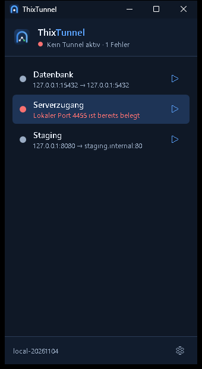
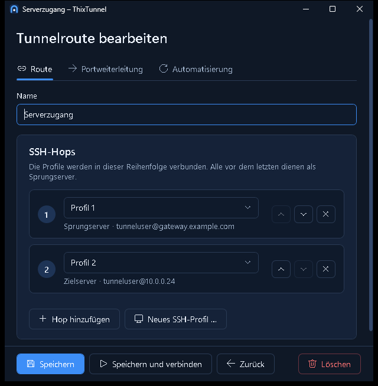
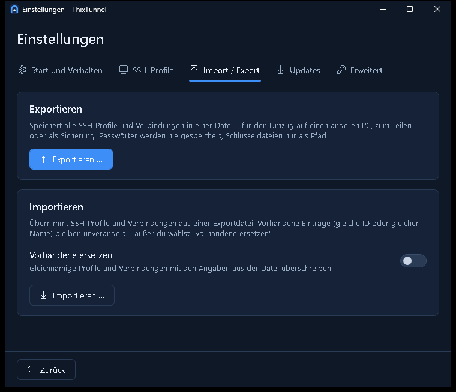
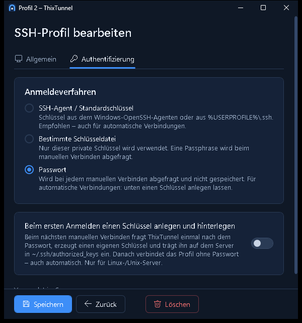
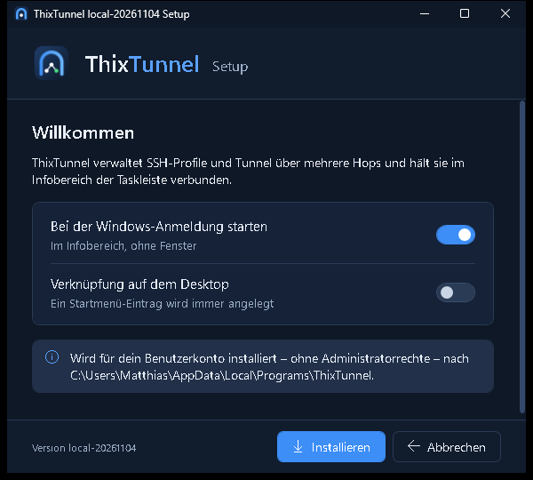

<p align="center">
  
</p>

**SSH-Profile, mehrere Hops und lokale Portweiterleitungen als Tray-App für Windows und macOS.**

ThixTunnel bündelt wiederkehrende SSH-Tunnel in einer kleinen Anwendung für Windows und macOS – eine Codebasis, dasselbe Programm. Ein **SSH-Profil** beschreibt die Anmeldung an einem Server; eine **Verbindung** reiht Profile in fester Reihenfolge auf (Sprungserver → … → Zielserver) und macht einen entfernten Dienst über einen lokalen Port erreichbar. Unter der Haube arbeitet der OpenSSH-Client des Systems – im Kern `ssh -N -J … -L …`.

**Projektstatus: Version 0.1.** Profile, Verbindungen über mehrere Hops, Verbinden/Trennen mit Status, Tray bzw. Menüleiste, Autostart, Auto-Verbindung, Wiederverbindung, Schlüssel-Einrichtung, Import/Export, eigenes Setup (Windows), App-Paket (macOS) und Updates sind umgesetzt. Die Mac-Version wird in CI gebaut und getestet, ist aber noch nicht signiert (siehe [Installation](#installation-und-updates)). Grundlage sind das [Anwendungskonzept](docs/konzept.md) und die [Mockups](docs/mockups/README.md).

<p align="center">
  
</p>

## Die Idee

**Lokaler Port 4455 → Server A → Server B → Ziel 127.0.0.1:4453.** A ist der Sprungserver, B der letzte SSH-Server; das Ziel wird aus Sicht von B angesprochen (`127.0.0.1` = B selbst). ThixTunnel startet dafür

```powershell
ssh -N -J A -L 127.0.0.1:4455:127.0.0.1:4453 B
```

hält den Prozess im Hintergrund am Leben und zeigt den Zustand im Fenster und im Tray bzw. in der Menüleiste. Jeder Hop meldet sich mit seinem eigenen Profil an; alle Schlüssel bleiben auf dem eigenen Rechner – auf A muss kein Schlüssel für B liegen.

## Schnellstart

1. Aus dem [Release-Kanal](https://github.com/Real-TTX/ThixTunnel/releases/tag/release-channel) laden:
   - **Windows:** `ThixTunnelSetup.exe` starten – installiert für das eigene Benutzerkonto, ohne Adminrechte.
   - **macOS:** `ThixTunnel-macOS-arm64.dmg` (Apple Silicon) bzw. `-x64.dmg` (Intel) öffnen und ThixTunnel nach „Programme“ ziehen. Beim ersten Start einmal mit Rechtsklick › Öffnen bestätigen (noch ohne Apple-Signatur).
2. Zahnrad unten rechts → **Einstellungen › SSH-Profile**: je Server ein Profil (Adresse, Port, Benutzer, Anmeldung).
3. **Einstellungen › Verbindungen › Neue Verbindung**: Hops in Reihenfolge wählen, lokalen Port und Ziel eintragen, speichern.
4. Im Hauptfenster auf ▷ klicken (oder doppelklicken). Beim ersten Mal fragt ThixTunnel unbekannte Hostschlüssel und ggf. Passwörter ab.

Bestehende Verbindungen eines anderen Rechners übernimmst du über **Einstellungen › Import / Export** – auch zwischen Windows und macOS.

## Funktionen

| Bereich | Verhalten |
| --- | --- |
| Hauptfenster | Schmal und hoch wie eine Kontaktliste: nur die Verbindungen mit Statuspunkt, Adressen bzw. Fehlermeldung und Knopf zum Verbinden/Trennen (auch Doppelklick oder Enter). Unten links die Version (öffnet „Über“), unten rechts die Einstellungen. Verwaltet wird nur in den Einstellungen. |
| Verbindungen | Einstellungen › „Verbindungen“: Suche, Filter, Sortierung; anlegen, bearbeiten (eigenes Fenster mit den Reitern Route, Portweiterleitung, Automatisierung), ssh-Befehl kopieren, löschen. Bis zu 10 Hops je Verbindung, je eine lokale TCP-Portweiterleitung. |
| SSH-Profile | Einstellungen › „SSH-Profile“: Server, SSH-Port, Benutzer und Anmeldung – SSH-Agent, bestimmte Schlüsseldatei oder Passwort. Ein Profil kann in vielen Verbindungen stecken. |
| Anmeldung | Passwörter, Passphrasen und unbekannte Hostschlüssel werden nur beim **manuellen** Verbinden per Dialog abgefragt (SSH_ASKPASS) und nie gespeichert. Geänderte Hostschlüssel werden immer abgelehnt. |
| Schlüssel einrichten | Passwort-Profil mit „Beim ersten Anmelden einen Schlüssel anlegen und hinterlegen“: beim nächsten manuellen Verbinden einmal das Passwort, dann erzeugt ThixTunnel einen eigenen ed25519-Schlüssel (im Datenordner unter `keys`), trägt ihn – auch durch Sprungserver hindurch – in `~/.ssh/authorized_keys` ein und stellt das Profil auf diesen Schlüssel um. Danach verbindet es ohne Passwort, auch automatisch. Für Linux-/Unix-Server. |
| Import / Export | Einstellungen › „Import / Export“: alle Profile und Verbindungen als Datei (`*.thixtunnel.json`) – für Umzug, Teilen oder Sicherung. Ohne Passwörter, Schlüsseldateien nur als Pfad. Vorhandene Einträge bleiben oder werden auf Wunsch ersetzt; was nicht passt (z. B. belegter Port), wird benannt. |
| Status | Je Verbindung: Getrennt, Verbindet, Verbunden, Wartet, Fehler – mit verständlicher Meldung (z. B. „Lokaler Port 4455 ist bereits belegt“). |
| Automatik | Je Verbindung: beim App-Start verbinden und nach Abbruch erneut verbinden (wachsende Pausen, sofortiger Versuch bei Netzwerkwechsel und nach Standby). Automatische Versuche fragen nie nach; Anmelde- und Hostschlüsselfehler werden nicht wiederholt. |
| Tray / Menüleiste | Statuspunkt im Symbol, Tooltip, Menü mit allen Verbindungen (verbinden/trennen), „Automatik pausieren“, Einstellungen, Beenden. Hinweise (Fehler, Update) erscheinen als kurze Einblendung neben dem Symbol. |
| Fenster | Jedes Fenster passt auch auf kleine Bildschirme. Fenster-X lässt die Tunnel im Hintergrund weiterlaufen (einstellbar); „Beenden“ trennt alle. Ein zweiter Programmstart (macOS: Klick aufs Dock-Symbol) öffnet das vorhandene Fenster. |
| Aufräumen | Windows: alle ssh-Prozesse hängen an einem Job-Objekt – auch nach einem Absturz bleibt kein Tunnel zurück. macOS: beim Beenden werden alle getrennt, nach einem Absturz räumt der nächste Start übrig gebliebene ssh-Prozesse seiner Verbindungen ab. |
| Autostart | „Bei der Anmeldung starten“ (Windows: HKCU\…\Run, macOS: LaunchAgent in `~/Library/LaunchAgents`) und „Im Hintergrund starten“ – unabhängig von der Auto-Verbindung je Verbindung. |
| Setup | Windows: die Programmdatei ist ihr eigenes Setup (wie beim Matgate-Agent): Installation für das eigene Benutzerkonto ohne Adminrechte, Startmenü, optionale Desktop-Verknüpfung, optionaler Autostart, Eintrag unter „Installierte Apps“; Deinstallation mit Rückfrage zu den Benutzerdaten. macOS: `ThixTunnel.app` aus dem Disk-Image nach „Programme“ ziehen, zum Entfernen in den Papierkorb. |
| Updates (OTA) | Prüfung beim Start und alle 6 Stunden, Installation mit einem Klick – Windows ersetzt die Programmdatei, macOS das App-Paket. Optional **voll-automatisch**: installiert selbst, startet neu und verbindet vorher aktive Tunnel wieder. |
| Richtlinien | Administratoren können sperren: `LockConfiguration`, `DenyNetworkBinding` (nur Loopback), `DisableUpdates` – Windows unter `HKLM\SOFTWARE\Policies\ThixTunnel` (DWORD = 1), macOS per Konfigurationsprofil für die Domain `info.schmoldt.thixtunnel` (Wert `true`). Geprüft wird im Business-Layer. |

| Verbindung bearbeiten (eigenes Fenster) | Einstellungen › Verbindungen |
| --- | --- |
|  |  |

| Profil: Schlüssel beim ersten Anmelden | Setup |
| --- | --- |
|  |  |

## Installation und Updates

Jeder Build wird in GitHub Actions für Windows und macOS gebaut, getestet und veröffentlicht:

| Kanal | Branch | Version | Download |
| --- | --- | --- | --- |
| Release | `main` | `<major>.<minor>.<build>-<datum>`, z. B. `0.1.42-20261104` | [release-channel](https://github.com/Real-TTX/ThixTunnel/releases/tag/release-channel) und je Version `v<version>` |
| Nightly | `dev` | `nightly-<build>-<datum>`, z. B. `nightly-43-20261104` | [nightly-channel](https://github.com/Real-TTX/ThixTunnel/releases/tag/nightly-channel) (Vorabversion) |
| Lokal | jeder andere Build | `local-<datum>` | – (Workflow-Artefakt bei Pull Requests) |

| Paket | System | Zweck |
| --- | --- | --- |
| `ThixTunnelSetup.exe` | Windows x64 | Setup, Update und Programm in einer Datei |
| `ThixTunnel-macOS-arm64.dmg` / `-x64.dmg` | macOS (Apple Silicon / Intel) | Erstinstallation: App nach „Programme“ ziehen |
| `ThixTunnel-macOS-arm64.zip` / `-x64.zip` | macOS | Update-Paket, das eine installierte App selbst lädt |
| `thixtunnel-update.json` | alle | Update-Manifest: Version, Kanal, Build-Nummer und je Plattform Paket + SHA-256 |

**Windows:** `ThixTunnelSetup.exe` ist das Programm selbst: aus dem Download gestartet, zeigt es den Setup-Assistenten und installiert sich nach `%LocalAppData%\Programs\ThixTunnel`. Ist ThixTunnel schon installiert, wird daraus ein Update (Autostart und Verknüpfungen bleiben, wie sie sind). Mit `--update` läuft es still als Update, mit `--uninstall` als Deinstallation (so steht es unter „Installierte Apps“). Benutzerdaten liegen getrennt unter `%AppData%\ThixTunnel`.

**macOS:** `ThixTunnel.app` liegt nach dem Ziehen in „Programme“; Benutzerdaten liegen unter `~/Library/Application Support/ThixTunnel`. Ein Update lädt das Zip, prüft die SHA-256, tauscht nach dem Beenden das App-Paket aus und startet ThixTunnel wieder in der Menüleiste. Die App ist bisher nur ad hoc signiert (ohne Apple-Developer-Konto): Gatekeeper fragt beim ersten Start nach – Rechtsklick › Öffnen, ab macOS 15 unter Systemeinstellungen › Datenschutz & Sicherheit › „Trotzdem öffnen“. Alternativ im Terminal: `xattr -dr com.apple.quarantine /Applications/ThixTunnel.app`.

Eine installierte Version prüft nur ihren eigenen Kanal und lädt nur das Paket ihrer Plattform. Benutzerdaten bleiben bei Updates erhalten.

Voraussetzung ist ein **OpenSSH-Client**: unter Windows der Windows-OpenSSH-Client (`C:\Windows\System32\OpenSSH\ssh.exe`, optionales Windows-Feature), unter macOS das mitgelieferte `/usr/bin/ssh`. Auf Sprungservern muss TCP-Weiterleitung erlaubt sein (`AllowTcpForwarding`, meist Standard).

## Entwicklung

```powershell
dotnet build ThixTunnel.slnx                         # 0 Warnungen, 0 Fehler
dotnet test ThixTunnel.slnx                          # Unit- und Business-Layer-Tests
powershell -File scripts\e2e-docker.ps1              # echter 2-Hop-Tunnel und Schlüssel-Einrichtung gegen Docker-SSH-Server
powershell -File scripts\build-icons.ps1             # Icon (.ico) und PNGs aus der Logo-Geometrie
$env:THIXTUNNEL_DATA_DIR = "C:\temp\thixtunnel-demo" # App mit eigenem Datenordner starten (eigene Instanz neben der installierten)
```

Ein Debug-Build ist nie ein Setup; nur die veröffentlichte Einzeldatei (`dotnet publish -r win-x64`) installiert sich selbst. Das Mac-Paket baut `scripts/package-macos.sh` auf einem Mac aus `dotnet publish -r osx-arm64` (bzw. `osx-x64`); in CI läuft das auf `macos-latest`.

| Pfad | Inhalt |
| --- | --- |
| `src/ThixTunnel.Core` | Modelle, Business-Layer (statische Klassen, Berechtigungsprüfung in jeder Änderung: Profile, Verbindungen, Tunnel, Import/Export, Schlüssel-Einrichtung, Setup, App-Paket, Updates), Infrastruktur (JSON-Speicher, ssh-Konfiguration, Prozesse, Job-Objekt); Windows- und Mac-Eigenheiten hinter Plattformweichen |
| `src/ThixTunnel` | Avalonia-Oberfläche für Windows und macOS (Verbindungsliste, Einstellungen, eigene Fenster), Setup-Assistent (Windows), Tray/Menüleiste, SSH_ASKPASS-Dialog, Update-Steuerung, wiederverwendbare Controls; Icons aus der mitgelieferten Schrift Fluent UI System Icons (MIT) |
| `tests/ThixTunnel.Tests` | xUnit-Tests; `EndToEndTests` laufen nur über `scripts/e2e-docker.ps1` (`tests/e2e/Dockerfile`) |
| `branding/` | Logo in Detailstufen: voll (`logo-full.svg`), App-Icon (`logo-icon.svg`), klein/Favicon (`logo-small.svg`), Tray-Glyph (`logo-tray.svg`) |
| `.github/workflows/build.yml` | Build und Test auf Windows und macOS, Setup-Datei, Mac-Pakete (dmg/zip), Update-Manifest und Veröffentlichung je Kanal |
| `scripts/package-macos.sh` | `ThixTunnel.app` mit Info.plist, Icon und Ad-hoc-Signatur, dazu Update-Zip und Disk-Image |

Branches: `main` (Release) und `dev` (Nightly). Entwicklungsregeln stehen in [CLAUDE.md](CLAUDE.md).

## Orientierung an Matmon und Matgate

[Matmon](https://github.com/Real-TTX/Matmon) war die Referenz für Tray-Bedienung, Installationsablauf und das Update-Prinzip über rollierende GitHub-Releases je Kanal. ThixTunnel läuft im Benutzerkonto statt als Dienst; wie beim [Matgate](https://github.com/Real-TTX/Matgate)-Agent ist die Programmdatei selbst das Setup – ohne fremdes Installer-Werkzeug.
