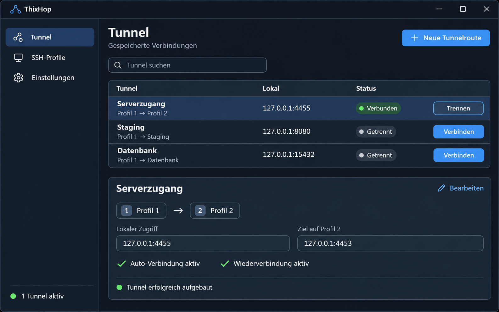

# ThixTunnel

**SSH-Profile, mehrere Hops und lokale Portweiterleitungen als Windows-Tray-App.**

ThixTunnel soll wiederkehrende SSH-Verbindungen in einer übersichtlichen Windows-Anwendung bündeln. Nutzer speichern ihre SSH-Profile, stellen daraus Tunnelrouten zusammen und erreichen entfernte Dienste über einen lokalen Port. Ein Tray-Icon, ein Windows-Installer und ein einstellbarer Start bei der Windows-Anmeldung gehören zum geplanten Umfang.

**Projektstatus: Konzeptphase.** Dieses Repository dokumentiert die Anwendungsidee und die ersten UI-Mockups als Grundlage für die Umsetzung.

- [Anwendungskonzept und Anforderungen](docs/konzept.md)
- [Alle vier Mockups ansehen](docs/mockups/README.md)
- [Matmon als Referenz für Windows-Setup und Tray](https://github.com/Real-TTX/Matmon)

## Die Idee

Eine gespeicherte Route kann beispielsweise so aussehen:

**Lokaler Port 4455 → Profil 1 → Profil 2 → Ziel 127.0.0.1:4453.**

Profil 1 ist der Sprungserver; Profil 2 ist der letzte SSH-Server. Die Zieladresse wird aus Sicht dieses letzten Servers angesprochen. Die Anwendung verwaltet die SSH-Verbindungen im Hintergrund und macht ihren Zustand im Hauptfenster und im Tray sichtbar.

## Geplanter Funktionsumfang

| Bereich | Geplantes Verhalten |
| --- | --- |
| SSH-Profile | Serveradresse, SSH-Port, Benutzer und Authentifizierung speichern. |
| Tunnelrouten | Profile in einer festen Reihenfolge verbinden und mehrere SSH-Hops unterstützen. |
| Portweiterleitung | Lokale Adresse und lokalen Port sowie Zielhost und Zielport einstellen. |
| Verbindungssteuerung | Einzelne Routen verbinden, trennen und ihren Status anzeigen. |
| Tray | Status, Schnellzugriff auf Tunnel, Einstellungen und vollständiges Beenden. |
| Autostart | Die Anwendung optional bei der Windows-Anmeldung starten und im Tray öffnen. |
| Auto-Verbindung | Für jede Tunnelroute einzeln festlegen, ob sie beim App-Start verbunden wird. |
| Wiederverbindung | Nach einem unbeabsichtigten Abbruch optional erneut verbinden; manuelles Trennen respektieren. |
| Windows-Installer | Installation, Verknüpfungen, Autostart-Auswahl und Deinstallation anbieten. |
| Updates | Vorhandene Profile, Routen und Einstellungen erhalten. |

**Autostart und Auto-Verbindung sind getrennte Einstellungen:** Der Autostart betrifft die Anwendung, die Auto-Verbindung jeweils eine vollständige Tunnelroute.

## UI-Mockups

Die Bilder stammen aus der ersten Entwurfsrunde und tragen noch den damaligen Arbeitstitel **ThixHop**. Der Projektname lautet **ThixTunnel**. Die Bilder sind visuelle Entwürfe mit Beispieldaten; sie dokumentieren die geplante Bedienung.

### Tunnelübersicht

### Weitere Ansichten

| Ansicht | Inhalt |
| --- | --- |
| [Tunnelroute bearbeiten](docs/mockups/02-tunnelroute-bearbeiten.png) | Reihenfolge der SSH-Hops, Portweiterleitung und Automatisierung je Route. |
| [Einstellungen und Tray-Menü](docs/mockups/03-einstellungen-und-tray.png) | Windows-Autostart, Hintergrundbetrieb und Schnellzugriff im Tray. |
| [Windows-Installer](docs/mockups/04-windows-installer.png) | Benutzerinstallation, Verknüpfungen und optionale Autostart-Auswahl. |

**[Die vollständige Galerie zeigt alle vier Bilder direkt untereinander.](docs/mockups/README.md)**

## Orientierung an Matmon

[Matmon](https://github.com/Real-TTX/Matmon) ist die Referenz für den Windows-Installationsassistenten und die Bedienung über ein Tray-Icon. Matmon verwendet ein eigenes .NET-/WinForms-Setup und `NotifyIcon`. Die konkreten Quellen und die für ThixTunnel geplanten Verhaltensregeln sind im [Anwendungskonzept](docs/konzept.md#8-matmon-als-konkrete-referenz) dokumentiert.

## Nächster Umsetzungsschritt

Die erste Umsetzung soll SSH-Profile, einen Routen-Editor und den manuellen Verbindungsaufbau mit Statusanzeige abdecken. Darauf bauen Tray-Bedienung, Autostart, automatische Wiederverbindung und der Windows-Installer auf. Anforderungen und Abnahmekriterien stehen im [Konzept](docs/konzept.md).
