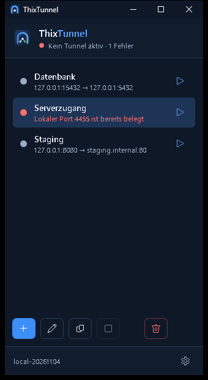
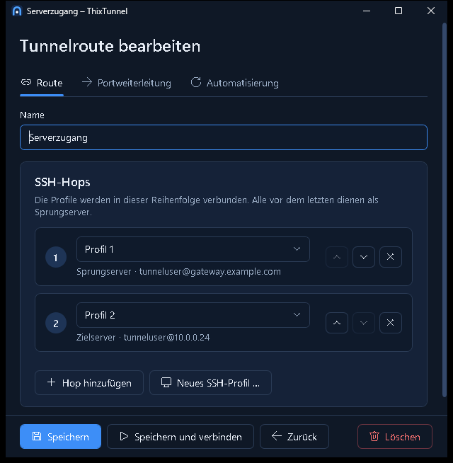
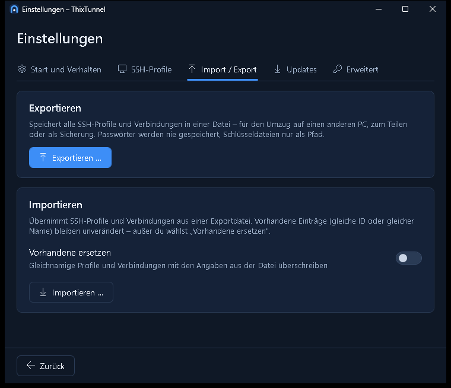

<p align="center">
  
</p>

**SSH-Profile, mehrere Hops und lokale Portweiterleitungen als Windows-Tray-App.**

ThixTunnel bündelt wiederkehrende SSH-Verbindungen in einer übersichtlichen Windows-Anwendung. SSH-Profile beschreiben die Anmeldung an je einem Server; Tunnelrouten verbinden Profile in fester Reihenfolge und machen einen entfernten Dienst über einen lokalen Port erreichbar. Unter der Haube arbeitet der Windows-OpenSSH-Client – im Kern `ssh -N -J … -L …`.

**Projektstatus: Version 0.1 – erste Umsetzung.** Profile, Multi-Hop-Verbindungen, Verbinden/Trennen mit Status, Tray, Autostart, Auto-Verbindung, Wiederverbindung, Import/Export, Setup und Updates sind implementiert. Grundlage sind das [Anwendungskonzept](docs/konzept.md) und die [Mockups](docs/mockups/README.md).



## Die Idee

**Lokaler Port 4455 → Profil 1 → Profil 2 → Ziel 127.0.0.1:4453.** Profil 1 ist der Sprungserver, Profil 2 der letzte SSH-Server; das Ziel wird aus dessen Sicht angesprochen. ThixTunnel startet dafür

```powershell
ssh -N -J profil1 -L 127.0.0.1:4455:127.0.0.1:4453 profil2
```

verwaltet den Prozess im Hintergrund und zeigt den Zustand im Fenster und im Tray.

## Funktionen

| Bereich | Verhalten |
| --- | --- |
| Hauptfenster | Schmal und hoch wie eine Kontaktliste: nur die Verbindungen mit Statuspunkt, darunter die Aktionen. Doppelklick oder Enter verbindet bzw. trennt. Alles andere öffnet sich in eigenen Fenstern; jedes Fenster passt auch auf kleine Bildschirme. |
| SSH-Profile | In den Einstellungen (Reiter „SSH-Profile“): Server, SSH-Port, Benutzer und Anmeldung (SSH-Agent, bestimmte Schlüsseldatei oder Passwort). Ein Profil kann in vielen Verbindungen stecken. |
| Import / Export | In den Einstellungen: alle Profile und Verbindungen als Datei (`*.thixtunnel.json`) – für Umzug, Teilen oder Sicherung. Ohne Passwörter; vorhandene Einträge bleiben oder werden auf Wunsch ersetzt. Was nicht passt (z. B. belegter Port), wird benannt. |
| Tunnelrouten | Beliebig viele Hops (bis 10) in fester Reihenfolge, je eine lokale TCP-Portweiterleitung. |
| Verbinden | Status je Route (Verbunden, Verbindet, Wartet, Fehler) mit verständlicher Fehlermeldung und dem entsprechenden ssh-Befehl. |
| Anmeldung | Passwörter, Passphrasen und unbekannte Hostschlüssel werden beim **manuellen** Verbinden per Dialog abgefragt (SSH_ASKPASS) und nie gespeichert. Geänderte Hostschlüssel werden immer abgelehnt. |
| Automatik | Pro Route: beim App-Start verbinden und nach Abbruch erneut verbinden (wachsende Pausen, sofortiger Versuch bei Netzwerkwechsel und nach Standby). Automatische Versuche fragen nie nach. |
| Tray | Statuspunkt im Symbol, Tooltip, Menü mit allen Tunneln, „Automatik pausieren“, Einstellungen, Beenden. |
| Fenster | Fenster-X lässt die Tunnel im Tray weiterlaufen (einstellbar); „Beenden“ trennt alle Tunnel. Ein zweiter Programmstart öffnet das vorhandene Fenster. |
| Aufräumen | Alle ssh-Prozesse hängen an einem Windows-Job-Objekt – auch nach einem Absturz bleibt kein Tunnel zurück. |
| Autostart | „Bei Windows-Anmeldung starten“ (HKCU\…\Run) und „Im Tray starten“ – unabhängig von der Auto-Verbindung je Route. |
| Setup | Die Programmdatei ist ihr eigenes Setup (wie beim Matgate-Agent): Installation für das eigene Benutzerkonto ohne Adminrechte, Startmenü, optionale Desktop-Verknüpfung, optionaler Autostart, Eintrag unter „Installierte Apps“, Deinstallation mit Rückfrage zu den Benutzerdaten. |
| Updates (OTA) | Prüfung beim Start und alle 6 Stunden, Installation mit einem Klick. Optional **voll-automatisch**: installiert selbst, startet neu und verbindet vorher aktive Tunnel wieder. |
| Richtlinien | Administratoren können unter `HKLM\SOFTWARE\Policies\ThixTunnel` (DWORD = 1) sperren: `LockConfiguration`, `DenyNetworkBinding` (nur Loopback), `DisableUpdates`. |

| Verbindung bearbeiten (eigenes Fenster) | Einstellungen: Import / Export |
| --- | --- |
|  |  |

## Installation und Updates

Jeder Build wird in GitHub Actions gebaut und als Setup veröffentlicht:

| Kanal | Branch | Version | Download |
| --- | --- | --- | --- |
| Release | `main` | `<major>.<minor>.<build>-<datum>`, z. B. `0.1.42-20261104` | [release-channel](https://github.com/Real-TTX/ThixTunnel/releases/tag/release-channel) und je Version `v<version>` |
| Nightly | `dev` | `nightly-<build>-<datum>`, z. B. `nightly-43-20261104` | [nightly-channel](https://github.com/Real-TTX/ThixTunnel/releases/tag/nightly-channel) (Vorabversion) |
| Lokal | jeder andere Build | `local-<datum>` | – (Workflow-Artefakt bei Pull Requests) |

`ThixTunnelSetup.exe` ist das Programm selbst: aus dem Download gestartet, zeigt es den Setup-Assistenten und installiert sich nach `%LocalAppData%\Programs\ThixTunnel`; mit `--update` läuft es still als Update, mit `--uninstall` als Deinstallation (so steht es unter „Installierte Apps“). Eine installierte Version prüft nur ihren eigenen Kanal (`thixtunnel-update.json` im Kanal-Release, mit SHA-256 des Setups). Benutzerdaten liegen getrennt unter `%AppData%\ThixTunnel` und bleiben bei Updates erhalten.

Voraussetzung ist der **Windows-OpenSSH-Client** (`C:\Windows\System32\OpenSSH\ssh.exe`, optionales Windows-Feature).

## Entwicklung

```powershell
dotnet build ThixTunnel.slnx                         # 0 Warnungen, 0 Fehler
dotnet test ThixTunnel.slnx                          # Unit- und Business-Layer-Tests
powershell -File scripts\e2e-docker.ps1              # echter 2-Hop-Tunnel gegen Docker-SSH-Server
powershell -File scripts\build-icons.ps1             # Icon (.ico) und PNGs aus der Logo-Geometrie
$env:THIXTUNNEL_DATA_DIR = "C:\temp\thixtunnel-demo" # App mit separatem Datenordner starten
```

| Pfad | Inhalt |
| --- | --- |
| `src/ThixTunnel.Core` | Modelle, Business-Layer (statische Klassen, Berechtigungsprüfung in jeder Änderung), Infrastruktur (JSON-Speicher, ssh-Konfiguration, Prozesse, Job-Objekt) |
| `src/ThixTunnel` | WPF-Oberfläche (Verbindungsliste, eigene Fenster), Setup-Assistent, Tray, SSH_ASKPASS-Dialog, Update-Steuerung, wiederverwendbare Controls |
| `tests/ThixTunnel.Tests` | xUnit-Tests; `EndToEndTests` laufen nur über `scripts/e2e-docker.ps1` |
| `branding/` | Logo in drei Detailstufen: voll (`logo-full.svg`), App-Icon (`logo-icon.svg`), klein/Favicon (`logo-small.svg`), Tray-Glyph (`logo-tray.svg`) |
| `.github/workflows/build.yml` | Build, Test, Setup, Update-Manifest und Veröffentlichung je Kanal |

Branches: `main` (Release) und `dev` (Nightly). Entwicklungsregeln stehen in [CLAUDE.md](CLAUDE.md).

## Orientierung an Matmon

[Matmon](https://github.com/Real-TTX/Matmon) war die Referenz für Tray-Bedienung, Installationsablauf und das Update-Prinzip über rollierende GitHub-Releases je Kanal. ThixTunnel läuft im Benutzerkonto statt als Windows-Dienst; wie beim [Matgate](https://github.com/Real-TTX/Matgate)-Agent ist die Programmdatei selbst das Setup – ohne fremdes Installer-Werkzeug.
