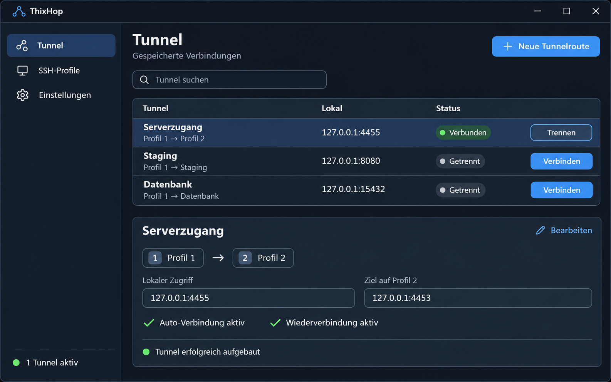
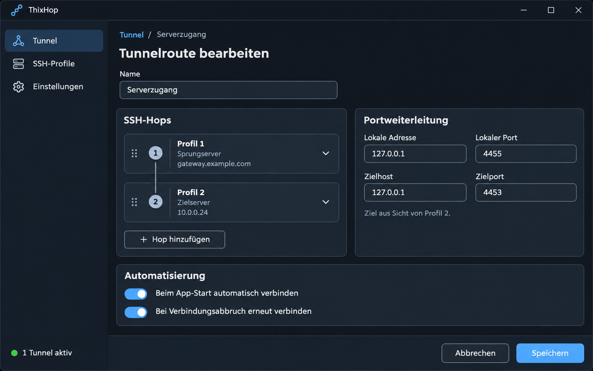
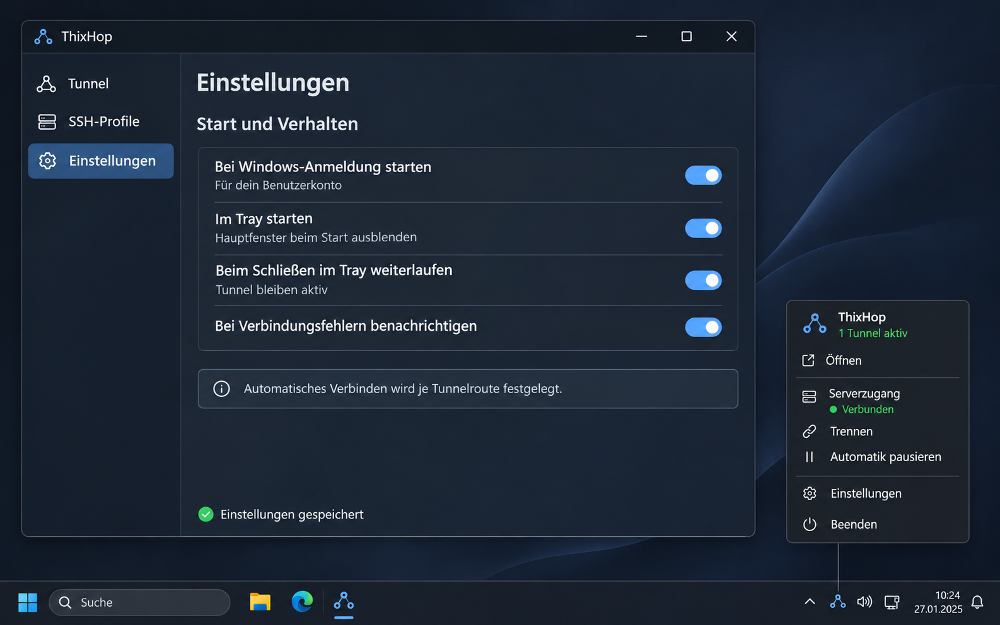
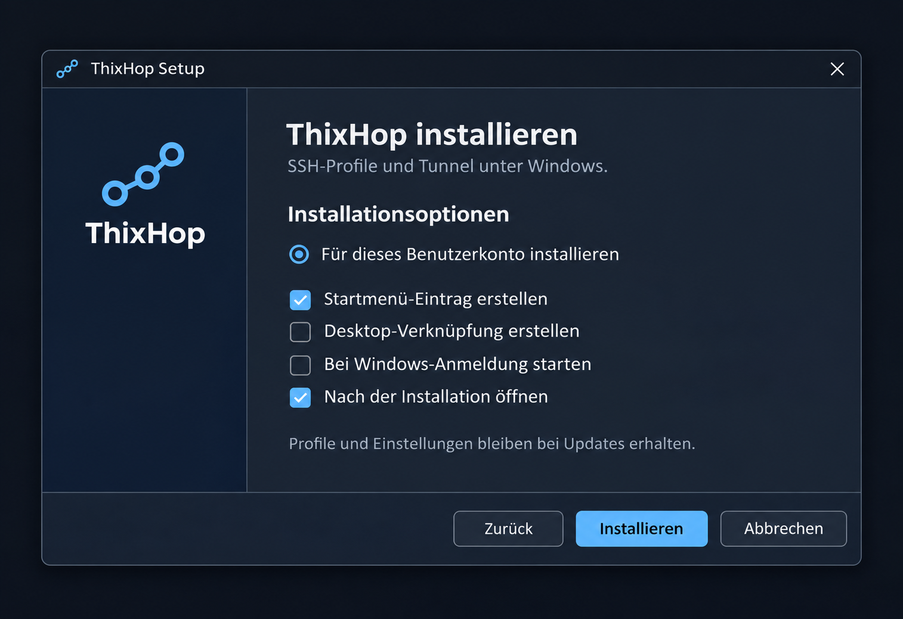

# ThixTunnel – Mockup-Galerie

Vier visuelle Entwürfe für die geplante Windows-Anwendung mit SSH-Profilen, Multi-Hop-Tunneln, Tray-Icon und Installer.

**Zum Namen:** In den Bildern steht noch **ThixHop**, der Arbeitstitel der ersten Entwurfsrunde. Das Projekt heißt inzwischen **ThixTunnel**. Die Originalentwürfe sind hier vollständig abgelegt. Servernamen, Adressen, Statusanzeigen und Uhrzeiten in den Bildern sind Beispieldaten.

[Zur Projektübersicht](../../README.md) · [Zum Anwendungskonzept](../konzept.md)

## 1. Tunnelübersicht

Die Übersicht zeigt gespeicherte Routen, lokale Anschlüsse, ihren Verbindungsstatus und die Aktionen zum Verbinden oder Trennen. Die Details der ausgewählten Route machen die SSH-Hops und die Weiterleitung von lokalem Port `4455` auf Zielport `4453` sichtbar.

[Originalbild öffnen](01-tunneluebersicht.png)

## 2. Tunnelroute bearbeiten

Der Editor führt SSH-Hops als geordnete Liste. Die Portweiterleitung hat eigene Felder für lokale Adresse, lokalen Port, Zielhost und Zielport. Automatisches Verbinden beim App-Start und Wiederverbinden nach einem Abbruch werden für diese Route eingestellt.

[Originalbild öffnen](02-tunnelroute-bearbeiten.png)

## 3. Einstellungen und Tray-Menü

Die globalen Einstellungen steuern den Start bei der Windows-Anmeldung, den Start im Tray und das Weiterlaufen bei geschlossenem Hauptfenster. Das Tray-Menü bietet Zugriff auf den aktiven Tunnel, Einstellungen und das vollständige Beenden der Anwendung.

[Originalbild öffnen](03-einstellungen-und-tray.png)

## 4. Windows-Installer

Der Installationsentwurf zeigt die Installation für ein Benutzerkonto sowie Optionen für Startmenü, Desktop-Verknüpfung und Windows-Autostart. Die konkrete Setup-Implementierung wird anhand der Anforderungen und der vorhandenen Matmon-Referenz festgelegt.

[Originalbild öffnen](04-windows-installer.png)

## Gestaltung

- Dunkle Windows-Oberfläche mit blauen Bedienelementen.
- Deutsche Beschriftungen und eine kompakte Navigation für Tunnel, SSH-Profile und Einstellungen.
- Verbindungszustände werden durch Text und Symbole kenntlich gemacht.
- Globaler App-Autostart und automatische Verbindungen je Tunnelroute bleiben unabhängig einstellbar.

Die PNG-Dateien sind die ursprünglichen generierten UI-Mockups. Sie dienen als Grundlage für Gestaltung und Umsetzung; die im Konzept beschriebenen Regeln legen das geplante Verhalten fest.
